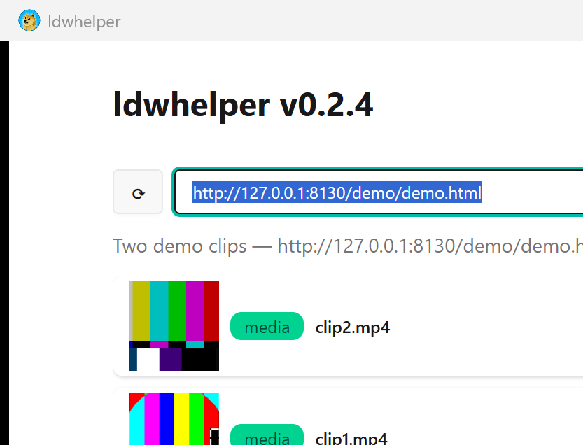

# ldwhelper

⭐ **If you find this project useful, please give it a star — it helps other people find it.**


<p align="center">
  
</p>

## What it is

ldwhelper is a Windows desktop application that downloads media files that are embedded in web pages.
You paste the address of a page, the application loads that page in an embedded browser running in the
background, watches which media the page actually requests, and lets you download the files it finds.

## Why it exists

Many pages do not link media directly in the page source. The file is assembled by a JavaScript player,
served from a different domain, delivered as an HLS/DASH playlist, or only reachable when the request
carries the right `Referer` header. Downloading such a file with a plain HTTP client usually fails,
because the client never reproduces what the browser does.

ldwhelper solves this by running the page in a real browser environment (WebView2, invisible) and
observing the network traffic and the DOM. It does not bypass DRM or any protection: it only captures
unprotected streams that the browser itself downloads while playing the page.

## Features

- **Automatic mode** — paste a page URL; the embedded browser runs in the background and every media
  candidate it detects is listed with a thumbnail, name, size and type. HLS/DASH playlists are marked
  as streams.
- **Manual mode** — a plain dialog where you enter a direct media URL, an optional Referer and a
  destination file.
- **Referer handling** — for automatic downloads the page origin is used as `Referer` (it can be
  switched off with a toggle); for manual downloads you type it yourself.
- **HLS/DASH support** — playlists are downloaded through an ffmpeg sidecar process and remuxed to MP4.
- **Direct downloads** — progressive files are downloaded with HTTP range requests, so pause and resume
  work; cancellation deletes the partial file.
- **System tray** — closing the window hides it to the tray; the application is closed from the tray
  menu, which also wipes the browser profile.
- **Command-line mode** — no UI at all if you pass arguments:
  ```
  ldwhelper <url> [referrer] [on|off]
  ldwhelper <url> <on|off>
  ```

## Typical use cases

- Saving a video that plays inside a page, when "view source" does not reveal the file.
- Downloading HLS/DASH streams that require an ffmpeg-based tool, without using the command line.
- Downloading files that need a specific `Referer` to be served.
- Quick one-shot downloads from the command line, with the same engine as the GUI.

## Privacy

- The embedded browser runs with a **dedicated throwaway profile**: cookies, cache and logins are
  deleted when the application exits.
- The list of saved referers (`referers.json`) is **encrypted with Windows DPAPI**, tied to your user
  account. If the file is corrupted, the application shows its path and refuses to overwrite it.

## Requirements

- Windows 10 or 11 (x64)
- WebView2 Runtime (preinstalled on Windows 11; the
  [Evergreen installer](https://developer.microsoft.com/microsoft-edge/webview2/) covers Windows 10)
- ffmpeg is bundled automatically through the `ffmpeg-sidecar` crate on first HLS download

## Install

Download `ldwhelper.exe` from the
[latest release](https://github.com/LucioPg/ldwhelper/releases/latest) and run it. No installer, no
registry changes, a single portable executable.

To build from source:

```
dx build --desktop --release
```

The bundled executable lands in `target/dx/ldwhelper/release/windows/app/`.

## Command line

```
Usage:
  ldwhelper                             Launch the graphical UI
  ldwhelper <url> [referrer] [spoofing] Direct download (no UI)
  ldwhelper <url> <spoofing>            No referrer: on|off only

Arguments:
  url       URL of the file or playlist (.m3u8/.mpd → HLS via ffmpeg)
  referrer  Referrer to send with the requests (optional)
  spoofing  on|off — sends the Referer header (default: on; on requires a referrer)
```

Progress is printed to stdout; the exit code is 0 on success, 1 on failure and 2 on invalid arguments.

## How it works, briefly

The application embeds a WebView2 browser on a background thread and talks to it through the Chrome
DevTools Protocol (`Network.enable`) to see every response, plus a small in-page script ("scout") that
inspects `<video>` elements and anchors — needed for players that live inside iframes and only start
loading after a play event. HLS playlists are handed to a bundled ffmpeg. The UI is built with
[Dioxus](https://dioxuslabs.com) and styled with DaisyUI.

## Author

**LucioPg** — [luciopg.github.io](https://luciopg.github.io)

Project page: [luciopg.github.io/ldwhelper](https://luciopg.github.io/ldwhelper/)

---
<p align="center"><a href="https://luciopg.github.io">luciopg.github.io</a> · <a href="https://luciopg.github.io/ldwhelper/">Project page</a> · <a href="https://github.com/LucioPg/ldwhelper/releases/latest">Download</a> · <a href="https://github.com/LucioPg/ldwhelper/issues">Issues</a></p>
